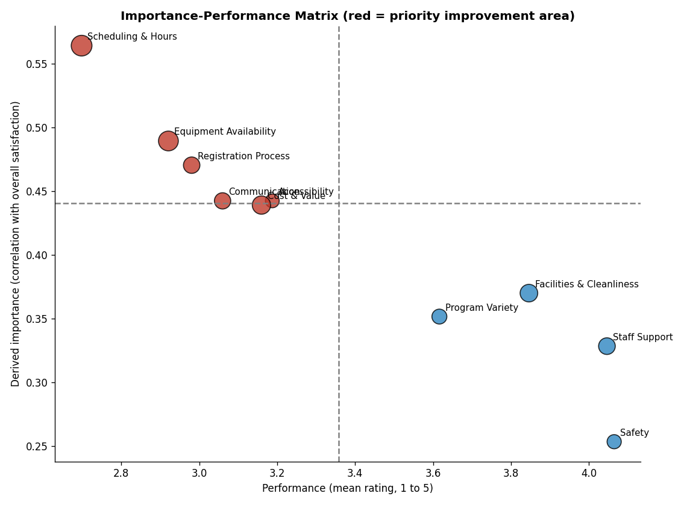
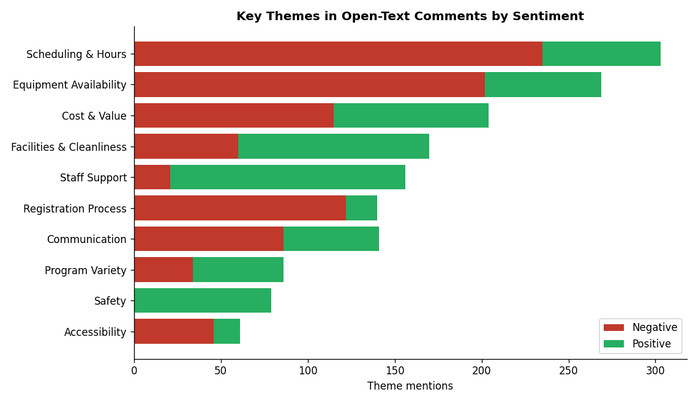
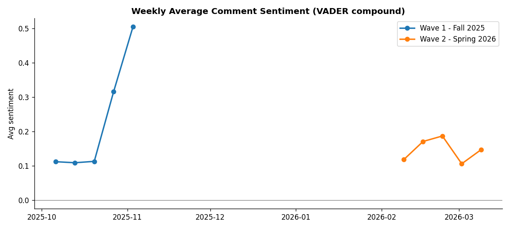
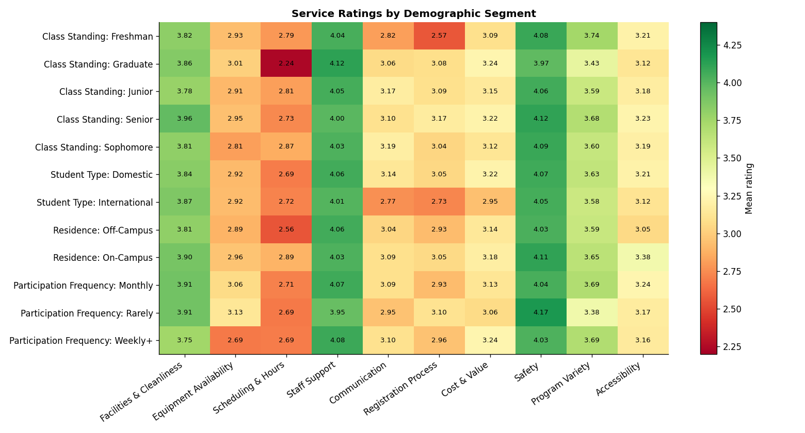
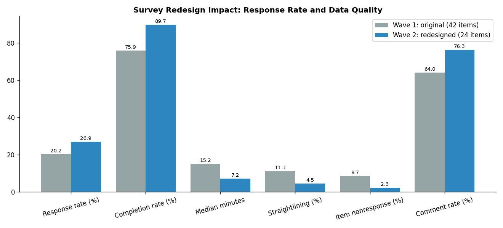

# Survey Analytics & Insights Dashboard

**Python | SQL (SQLite) | NLP (VADER, TF-IDF, NMF) | Tableau | Plotly**

End-to-end analysis of a two-wave student experience survey: sentiment and theme mining on open-text comments, demographic segmentation, importance-performance analysis to pick priority improvement areas, and a before/after evaluation of a survey redesign.



## Business Problem

Leadership receives hundreds of survey responses and comments each semester but no clear answer to three questions: **What are students unhappy about? Which groups feel it most? Where should we invest first?** The original survey was also long, and data quality was suffering.

## Key Results

| Metric | Result |
|---|---|
| Complete survey responses analyzed | **1,132** (1,360 survey starts) |
| Open-text comments scored for sentiment and themes | **804** |
| Priority improvement areas identified | **6** |
| Statistically significant segment gaps (p < 0.05) | **10** |
| Response rate after redesign | **20.3% to 26.9%** (+6.7 pts) |
| Completion rate after redesign | **75.9% to 89.7%** |
| Straightlining after redesign | **11.3% to 4.5%** |
| Item nonresponse after redesign | **8.7% to 2.3%** |

## Priority Improvement Areas

Ranked by a composite of derived importance (correlation with overall satisfaction), low performance and share of negative comments.

| Rank | Service Area | Mean (1 to 5) | Top-2-Box | Negative Comment Share |
|---|---|---|---|---|
| 1 | Scheduling & Hours | 2.70 | 20.8% | 76.8% |
| 2 | Equipment Availability | 2.92 | 25.3% | 75.1% |
| 3 | Registration Process | 2.98 | 29.0% | 82.4% |
| 4 | Communication | 3.06 | 32.1% | 60.1% |
| 5 | Accessibility | 3.19 | 36.2% | 66.7% |
| 6 | Cost & Value | 3.16 | 35.5% | 54.0% |

## Largest Segment Gaps

| Segment | Service Area | Group Mean | Everyone Else | Gap |
|---|---|---|---|---|
| Graduate students | Scheduling & Hours | 2.24 | 2.80 | -0.56 |
| Freshmen | Registration Process | 2.57 | 3.10 | -0.53 |
| Weekly+ users | Equipment Availability | 2.69 | 3.09 | -0.40 |
| International students | Communication | 2.77 | 3.14 | -0.37 |
| Off-campus students | Scheduling & Hours | 2.56 | 2.89 | -0.33 |

## Visuals

| Themes by sentiment | Weekly sentiment trend |
|---|---|
|  |  |

| Ratings by segment | Survey redesign impact |
|---|---|
|  |  |

An interactive dashboard is generated at `reports/dashboard.html` (download it and open in any browser). Tableau-ready extracts are in `tableau/`, with a step-by-step build guide in [`tableau/TABLEAU_GUIDE.md`](tableau/TABLEAU_GUIDE.md).

## Methodology

1. **Data** (`src/generate_data.py`): two survey waves (Fall 2025, 42 items; Spring 2026, redesigned to 24 items), 2,400 invitations each. Each response has demographics, 10 service-area ratings, overall satisfaction, NPS likelihood, completion time, a straightlining flag and an optional comment.
2. **SQL** (`sql/`): data normalized into 4 SQLite tables (invitations, respondents, ratings, comments). 8 queries cover response and completion rate, service-area scores and top-2-box, NPS, satisfaction by segment, and data quality by wave.
3. **Text analysis** (`src/text_analysis.py`):
   * VADER sentiment with a domain lexicon (e.g. "broken", "limited", "crashes") so campus feedback is scored correctly
   * Sentence-level theme tagging so each theme gets the sentiment of the sentence that mentions it
   * TF-IDF + NMF topic model for unsupervised theme discovery
   * Weekly sentiment trend across both waves
4. **Segmentation** (`src/segmentation.py`): importance-performance matrix, composite priority score, and a Welch t-test for every demographic group vs everyone else on every service area.
5. **Survey design review** (`src/survey_quality.py`): wave-over-wave comparison of response rate, completion, time, straightlining, item nonresponse and comment rate, with a log of the design changes made.
6. **Reporting** (`src/export_tableau.py`, `src/build_dashboard.py`): Tableau extracts plus a standalone Plotly dashboard.

### Survey Design Changes (Wave 1 to Wave 2)

| Area | Change |
|---|---|
| Length | 42 to 24 items, removed redundant and low-variance questions |
| Wording | Split double-barreled questions into single-concept items |
| Scale | One 5-point scale with labeled endpoints for all ratings |
| Flow | Demographics moved to the end, items grouped by service area |
| Attention check | Instructed-response item to flag straightlining |
| Mobile | Matrix grids replaced with mobile-friendly single items |
| Outreach | Personalized invitation plus two reminders timed to class breaks |

## Project Structure

```
survey-analytics-dashboard/
|-- main.py                     Runs the full pipeline
|-- requirements.txt
|-- sql/
|   |-- schema.sql
|   |-- analysis_queries.sql
|-- src/
|   |-- config.py
|   |-- generate_data.py
|   |-- load_database.py
|   |-- text_analysis.py
|   |-- segmentation.py
|   |-- survey_quality.py
|   |-- export_tableau.py
|   |-- build_dashboard.py
|-- data/
|   |-- raw/                    responses.csv, invitations.csv
|   |-- processed/              SQL outputs, scored comments, themes, gaps, priorities
|-- reports/
|   |-- dashboard.html
|   |-- figures/
|-- tableau/
    |-- TABLEAU_GUIDE.md
    |-- responses.csv
    |-- ratings_long.csv
    |-- priority_areas.csv
    |-- segment_priority_gaps.csv
    |-- theme_summary.csv
    |-- theme_mentions.csv
    |-- sentiment_trend_weekly.csv
    |-- survey_quality_by_wave.csv
    |-- survey_quality_change.csv
```

## How to Run (Windows CMD)

```cmd
cd survey-analytics-dashboard
python -m venv venv
venv\Scripts\activate
pip install -r requirements.txt
python main.py
start reports\dashboard.html
```

Run a single step, for example only the text analysis:

```cmd
python src\text_analysis.py
```

The pipeline runs in under a minute. All randomness is seeded, so results reproduce exactly.

## Data Note

The survey data is synthetic, generated to reflect realistic response patterns (segment-specific pain points, partial responses, straightlining, varied open-text feedback). No real respondent data is used. To analyze a real survey, replace the files in `data/raw/` with the same columns and run `python main.py --skip-generate`.

## Tech Stack

Python (pandas, NumPy, scikit-learn, SciPy, vaderSentiment, Matplotlib, Plotly), SQL (SQLite), Tableau.
